<p align="center">
  
</p>

<p align="center">
  
  
  
  
   
</p>
</p>

# APT Technique & Candidate Group Dashboard

A password-protected dashboard for the **Windows-APT 2025** project. Upload a Wazuh alert
export (CSV) and it will:

1. find the attack commands launched by the Caldera agent,
2. guess which **MITRE ATT&CK technique** each command is, and show *why*,
3. rank **candidate threat groups** whose known technique lists fit the evidence.

> **Candidate groups, not attribution.** The score measures how well technique lists fit.
> It is not a probability and not proof of who attacked. The ranking was tested on
> simulated attacks only.

---

## Contents

- [What you see in the dashboard](#what-you-see-in-the-dashboard)
- [How it works](#how-it-works)
- [Measured results](#measured-results)
- [Folder layout](#folder-layout)
- [Run it on your computer (Windows)](#run-it-on-your-computer-windows)
- [Deploy on Render](#deploy-on-render)
- [Your CSV file](#your-csv-file)
- [Security](#security)
- [Honest-use notes](#honest-use-notes)
- [Data and references](#data-and-references)

---

## What you see in the dashboard

| Tab | What it shows |
|---|---|
| **Overview** | What is in the uploaded file: rows, attack commands, computers, techniques guessed, low-confidence guesses. If you upload an answer key, live scores appear here. |
| **Techniques** | The model's top-3 technique guesses for every attack command, with scores and a confidence mark. Downloadable as CSV. |
| **Why? (SHAP)** | Which clues (alerts, programs, command words, files) pushed the model towards or away from a technique. |
| **Candidate groups** | Threat groups whose technique lists fit, with shared techniques, warnings for ties and weak evidence, and a reason for each rank. |
| **Simulation** | The semi-synthetic ranking test, live: hide part of a group's techniques, add unrelated ones, see where the group ranks. |
| **About** | What the scores mean and what they do not mean. |

The sidebar lets you switch between the **full model** and a **held-out model** that never
saw 9–10 December 2024, for an honest test on the demo days.

## How it works

```
Wazuh alerts (CSV)
      |
      v
 pipeline.py   find Caldera-launched commands, follow process IDs to collect each
               command's alerts ("trail"), build clues
      |
      v
 Linear SVM    TF-IDF clues -> technique scores, top-3 guesses, LOW-confidence mark
      |
      +--> explain.py   exact SHAP points for every clue
      |
      v
 ranker.py     Jaccard and weighted Jaccard against 36 group profiles
               -> ranked candidate groups, matched techniques, warnings
```

- **PS_GROUP:** 14 PowerShell techniques leave exactly the same trace in these logs (the
  dataset has no PowerShell log), so they are shown as one class.
- **Low confidence:** a guess is marked LOW when even the best SVM score is 0 or below.
- **Weighted Jaccard** gives more weight to techniques that few groups use.

## Measured results

Technique detection, macro-F1 (every technique counts equally):

| Test | Macro-F1 | Right answer in top 3 |
|---|---|---|
| Attacks seen before, on new days | 0.961 | 99.7% |
| Brand-new attacks (test hidden) | 0.402 | 70.3% |

Held-out demo model (trained without 9–10 Dec 2024, scored on those days):
first guess right **97.1%**, top 3 **99.6%**, macro-F1 **0.966**.
These are "seen attack, new day" results; brand-new attacks remain the harder case.

Group ranking (semi-synthetic, simulated observations):

| Score | Top-1 | Top-3 |
|---|---|---|
| Jaccard | 0.829 | 0.957 |
| Weighted Jaccard (main) | 0.818 | 0.951 |

Some groups share identical technique lists (for example APT 30 and APT12), so no
technique-based method can separate them. The dashboard shows a warning when this happens.

## Folder layout

```
mitre-dashboard/
  app.py                    the dashboard
  pipeline.py               alerts -> model inputs
  ranker.py                 Jaccard and weighted Jaccard group ranking
  explain.py                exact SHAP for the linear model
  auth.py                   login (cloud-ready: reads environment variables)
  make_password_hash.py     makes the hashed password
  make_synthetic.py         makes a small made-up test file
  requirements.txt          pinned package versions
  render.yaml               Render deployment settings
  assets/
    banner.svg              the banner at the top of this page
  .streamlit/
    config.toml             upload limit, XSRF protection, no usage stats
    secrets.toml.example    template for local login (copy to secrets.toml)
  models/                   full model
    final_model.joblib, final_model_info.json, shap_background_mean.npy,
    group_profiles.csv, rule_descriptions.csv, technique_names.csv,
    pipeline_settings.json
  models_holdout/           same files, model trained without 9-10 Dec 2024
```

`.streamlit/secrets.toml`, the dataset and any file with attack command text are listed in
`.gitignore` and are never uploaded.

## Run it on your computer (Windows)

Open a terminal in the project folder, then:

1. **Install the libraries (once)**, in the same Python environment as the notebook:
   ```
   pip install -r requirements.txt
   ```
2. **Set up the login (once):**
   ```
   python make_password_hash.py
   ```
   Copy `.streamlit\secrets.toml.example` to `.streamlit\secrets.toml`, then fill in:
   ```toml
   [auth]
   username = "your-username"
   password_hash = "$2b$12$...paste the printed hash..."
   ```
3. **Start the dashboard:**
   ```
   streamlit run app.py
   ```
   It opens at <http://localhost:8501>. Log in and upload your Wazuh CSV.

Stop it with **Ctrl + C**.

## Deploy on Render

The repo includes a `render.yaml` blueprint.

1. Push this repo to GitHub (private is recommended).
2. In Render choose **New -> Blueprint**, select the repo and allow access.
3. Enter the two secret values when asked (see the table below).
4. Click **Manual Deploy -> Deploy latest commit** and open the URL.

| Environment variable | Meaning | Example / default |
|---|---|---|
| `APP_USERNAME` | Login username | your choice |
| `APP_PASSWORD_HASH` | bcrypt hash from `make_password_hash.py` (starts with `$2b$`) | never the plain password |
| `PYTHON_VERSION` | Must match the Python used for training | set in `render.yaml` |
| `MAX_UPLOAD_ROWS` | Largest allowed upload, in alert rows | `100000` on Render, `300000` locally |
| `MAX_UNZIPPED_MB` | Largest allowed size after unzipping `.csv.gz` | `200` |

Notes for the free Render plan:
- 512 MB of memory is small. If you see "Out of memory", lower the two limits or upgrade the plan.
- The service sleeps after 15 minutes without visitors and takes about a minute to wake up.
- The disk is temporary; this app never writes uploads to disk anyway.
- Package versions in `requirements.txt` must match the ones that saved the model.
  The sidebar warns you if they differ.

## Your CSV file

A **Wazuh alert export**, one row per alert, `.csv` or `.csv.gz`.
Use *Download empty template* in the sidebar to get the exact column list.

**Required:** `_source.@timestamp`, `_source.agent.name`, `_source.rule.id`,
`_source.data.win.system.eventID`, and under `_source.data.win.eventdata.`:
`image`, `parentImage`, `commandLine`, `processGuid`, `parentProcessGuid`.

**Used if present (better results):** `_source.rule.description`, `_source.rule.mitre.id`,
and `sourceProcessGUID`, `targetFilename`, `targetObject`, `imageLoaded`,
`destinationPort`, `targetImage`, `queryName`.

An *attack* is any program whose parent is the Caldera agent (`splunkd.exe` or
`caldera-agent3.exe`); the dashboard follows the process IDs to collect its alerts.

## Security

- Password login; only a bcrypt hash of the password is stored or configured.
- After 5 wrong tries the login locks for 60 seconds; each new lock doubles the time
  (up to 15 minutes). The counter is shared by all visitors, not per browser tab.
- Upload: `.csv` or `.csv.gz` only, with size limits from `config.toml` (30 MB by default)
  and the row and unzip limits above.
- Uploads stay in memory for the current session and are never written to disk.
  Logging out clears them.
- Errors show a plain message, not the program's internals.
- The prediction download contains no command text.
- On a public URL the password is the only barrier. Share the link only with people who
  need it, and do not upload logs from real organisations.

## Honest-use notes

- Demo days come from the training data, so guesses on them look better than the measured
  scores. Use the held-out model, or quote the measured scores (About tab).
- Technique labels come from matching Caldera commands to Atomic Red Team tests, not from
  Wazuh's own tags (which were right for only about 15% of commands).
- Group scores measure fit, not probability. The ranking was tested on simulated attacks,
  because the dataset has no scenario or run labels for real-data scoring. The output is
  **candidate groups**, not the real attacker.
- Whole days contain many different attacks mixed together; rank one burst of activity on
  one computer for a meaningful result.

## Data and references

- **Dataset:** *Windows-APT 2025: A dataset for APT-inspired attack scenarios on Windows
  systems*, Data in Brief (2026), 65, 112569.
  DOI [10.1016/j.dib.2026.112569](https://doi.org/10.1016/j.dib.2026.112569).
  Data on Mendeley Data, Version 3, DOI 10.17632/b8fmtzvpy8.3.
  The dataset is **not** included in this repository; download it from Mendeley Data and
  check its licence.
- **Base paper:** Rani, Saha, Maurya and Shukla, *Decoding Shadows: Towards TTP-Based APT
  Attribution (ATTRACT)*.
  DOI [10.1080/19393555.2025.2543450](https://doi.org/10.1080/19393555.2025.2543450).
- **Knowledge base:** [MITRE ATT&CK](https://attack.mitre.org/) and
  [Atomic Red Team](https://github.com/redcanaryco/atomic-red-team).
